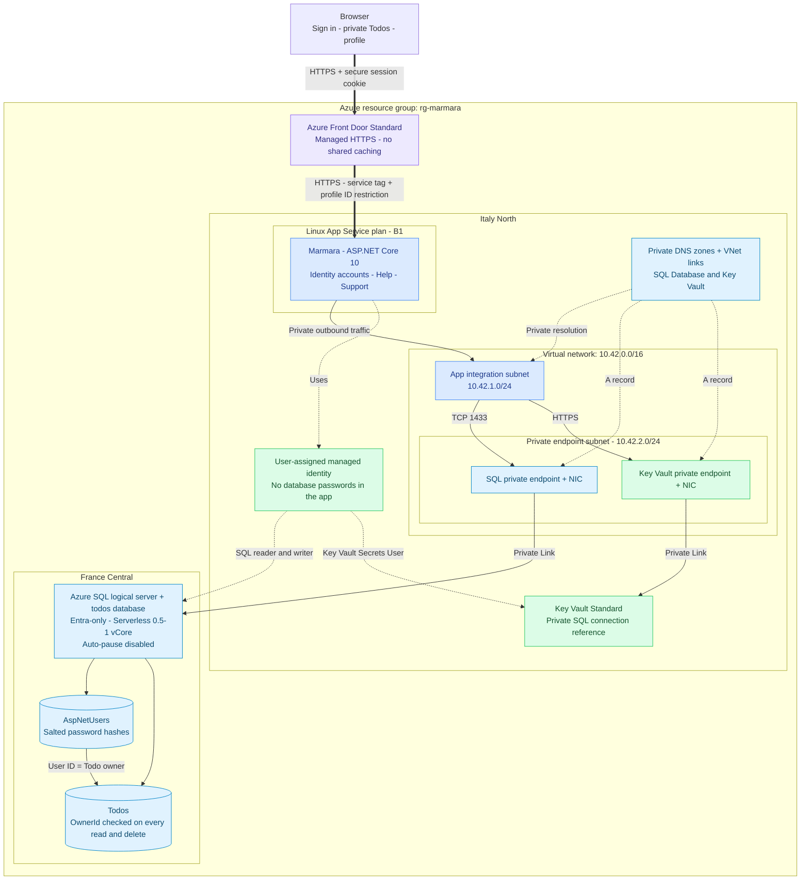

# marmara-demo

**[Open the Marmara web app](https://marmara-86fc72f2-fjcrcxdgcgfqgxb4.b01.azurefd.net)**

## Architecture



Only Front Door can reach the app origin. SQL and Key Vault have no public access. Browser users authenticate against SQL-backed Identity accounts; the app itself uses managed identity to connect to Azure services.

An authenticated, private Todo app based on the [Microsoft Learn ASP.NET Core + Azure SQL tutorial](https://learn.microsoft.com/en-us/azure/app-service/tutorial-dotnetcore-sqldb-app?tabs=copilot&pivots=azure-portal), deployed with Terraform and published through Azure Front Door Standard.

## Azure target

- Subscription: `44d3e5d8-23bc-4517-a680-f2d6359dd516`
- Existing resource group: [`rg-marmara`](https://portal.azure.com/#@MngEnvMCAP563244.onmicrosoft.com/resource/subscriptions/44d3e5d8-23bc-4517-a680-f2d6359dd516/resourcegroups/rg-marmara/overview)
- App, networking and Key Vault: Italy North, inherited from the resource group.
- SQL: France Central. This subscription restricts SQL provisioning in Italy North.
- SQL SKU: `GP_S_Gen5_1`, 0.5-1 vCore, 2 GB, kept online with auto-pause disabled.

Terraform **references** the existing resource group; it does not own, replace, or delete it.

## Tutorial-to-Terraform mapping

| Tutorial component | Implementation |
| --- | --- |
| Linux App Service | .NET 10, single-instance Basic B1, HTTPS and filesystem logs |
| Public endpoint | Front Door Standard, managed HTTPS, HTTP-to-HTTPS redirects, no shared caching |
| SQL server/database | Existing General Purpose serverless SKU, 2 GB, Entra-only authentication |
| Private networking | VNet, delegated App Service subnet, separate endpoint subnet |
| Private SQL and Key Vault | Two private endpoints and linked private DNS zones; public access disabled |
| Connection-string security | Private RBAC Key Vault with a password-free SQL connection-string reference |
| App identity | User-assigned identity with Key Vault Secrets User and SQL reader/writer roles |
| Application deployment | Tracked application source, local .NET publish, Entra-authenticated ZIP deployment |
| Database initialization | EF migrations run once inside App Service as the deployment identity |

The subscription policy denies SQL-password authentication. This conversion therefore uses the tutorial's **managed-identity/passwordless alternative**. The normal app is not a SQL administrator and has no DDL role. A user-assigned identity allows permissions to be created before the app.

Key Vault's connection string is created through its ARM management-plane API, so the vault never needs temporary public access. Key Vault soft deletion and purge protection are enabled.

The [original Microsoft sample](https://github.com/Azure-Samples/msdocs-app-service-sqldb-dotnetcore/tree/5d6e6bed95984b5f70343988d6485f235302d212) is included in [src/TodoApp](src/TodoApp), with its MIT license preserved. The app adds SQL-backed accounts, per-user Todos, profile management, Help/Support pages, and a responsive Marmara interface. No GitHub login, fork, push, or `azd` is required.

## Accounts and privacy

- Register and sign in with a username and password. ASP.NET Core Identity stores **salted password hashes** in SQL, never readable passwords.
- Passwords require 12+ characters, uppercase, lowercase, a digit, and a symbol. Five failed attempts lock the account for five minutes.
- Todo ownership is assigned by the server and checked on every read and delete. Legacy anonymous Todos remain unassigned and hidden; they are not given to a newly registered account.
- Profile supports username changes, password changes, and account deletion. Each requires the current password. Deletion atomically removes only the current account and its Todos.
- Password changes invalidate other sessions. Authentication cookies are Secure, HttpOnly, SameSite=Lax, and private pages use `no-store`; unsafe form actions require anti-forgery tokens.
- Help and Support are available from the top menu. Password recovery email is not configured; Support explains how to reach the application administrator without inventing a contact address.

## Front Door publishing

[infra/frontdoor.tf](infra/frontdoor.tf) creates the Standard profile, endpoint, HTTPS origin, `/health` probe, and uncached `/*` route. The default `*.azurefd.net` domain works without custom DNS.

App Service permits requests only from `AzureFrontDoor.Backend` with this profile's `X-Azure-FDID`. Direct access to the origin returns 403. The SCM endpoint remains accessible for Entra-authorized deployments; publishing passwords stay disabled.

`PUBLIC_ORIGIN` keeps authentication redirects on the Front Door hostname without trusting arbitrary forwarding headers. `/health` is a liveness-only probe; `/ready` checks SQL connectivity for deployment and diagnostics. SQL auto-pause is disabled as requested. The separate probes also permit future auto-pause without edge health checks keeping SQL awake.

## Deploy

Requirements: PowerShell 7 on Windows, Azure CLI, Terraform 1.11+, and the .NET 10 SDK. The local EF tool manifest pins the EF Core version.

```powershell
# If Terraform is not installed:
winget install --id Hashicorp.Terraform --exact

az login --tenant MngEnvMCAP563244.onmicrosoft.com
.\scripts\Deploy.ps1
```

The script builds the app and Linux migrations bundle **before** provisioning, validates Terraform, rejects resource deletion/replacement, applies the saved plan, deploys the app, initializes SQL through Front Door, and verifies `/ready`. Initial Front Door propagation can take several minutes.

Defaults are in [infra/variables.tf](infra/variables.tf); [infra/terraform.tfvars](infra/terraform.tfvars) sets the SQL-only region fallback. The SQL private endpoint remains in the app VNet and supports the cross-region connection without public SQL access. The script checks subscription-specific SQL offer availability before provisioning. Resources receive a stable suffix derived from the subscription, resource group, and prefix. Authentication is scoped per command; the script does not change the Azure CLI's global default subscription.

The SQL server name also includes its region to avoid Azure's name/location reservation left by a failed regional provisioning attempt.

The deployment identity needs resource provisioning and role-assignment permissions on the target group. By default it also becomes the SQL Entra administrator. If overriding `sql_administrator_object_id`, the identity running the deployment script must still have administrative SQL access.

For database initialization, the script sends a short-lived SQL access token over HTTPS to `POST /_deployment/initialize-database`, keeping it in memory rather than writing credentials to files or command-line arguments. Azure SQL validates the bearer token, and the bootstrap verifies database-owner membership before running migrations or creating the app user. Missing/invalid authentication is rejected; the app's normal reader/writer identity cannot bootstrap. The endpoint accepts no arbitrary SQL or user-supplied database configuration.

The contained SQL user's SID uses the identity's **application/client ID**, not its Entra object/principal ID, as required for service principals by the [SQL CREATE USER reference](https://learn.microsoft.com/en-us/sql/t-sql/statements/create-user-transact-sql#sid--sid). Bootstrap verifies the SID, Identity schema, database and reader/writer memberships. Entra object IDs are still used for Azure RBAC. No tenant-wide Directory Readers role is needed.

## Develop and test

```powershell
dotnet test .\tests\TodoApp.Tests\TodoApp.Tests.csproj --configuration Release
dotnet tool restore
dotnet ef database update --project .\src\TodoApp
dotnet run --project .\src\TodoApp --urls https://localhost:7043
```

Local development uses Windows SQL LocalDB with integrated authentication; no development database password is committed. Integration tests use an isolated in-memory SQLite database and exercise account management, hashing, anti-forgery, cross-user isolation, and Front Door redirects.

Useful commands:

```powershell
# Validate and inspect infrastructure without deploying:
terraform -chdir=infra init
terraform -chdir=infra fmt -check
terraform -chdir=infra validate
terraform -chdir=infra plan

# Build a package only:
.\scripts\Deploy.ps1 -PackageOnly

# Redeploy a previously built package without changing infrastructure:
.\scripts\Deploy.ps1 -PackagePath '<absolute ZIP path>' -SkipInfrastructure

# Show the actual Azure-assigned hostname and portal link:
terraform -chdir=infra output app_url
terraform -chdir=infra output resource_group_url
```

## State, cost, and cleanup

Keep `infra\terraform.tfstate` and its backups secure and persistent; they are git-ignored. Keep `.terraform.lock.hcl` in source control. This demo uses local state; use an access-controlled Azure Storage backend for shared/team deployments.

Front Door Standard adds a **USD 35/month base fee**, plus requests and transfer. Other fixed/reference costs are B1 about $13.14, two private endpoints about $14.60, and two private DNS zones about $1: approximately **$64/month before SQL compute/storage and traffic**.

Serverless SQL compute is usage-based. Auto-pause is disabled (`-1`) as requested, so compute can be billed even while the app is idle. Cross-region SQL traffic adds possible charges and latency. Private endpoint cost is a reference estimate; the other quoted meters were checked against Azure's retail API. Credits and discounts are not assumed.

To remove **only resources managed by this Terraform state**, first review:

```powershell
terraform -chdir=infra plan -destroy
terraform -chdir=infra destroy
```

Do not delete the shared resource group. Purge-protected Key Vault names remain reserved during the seven-day soft-delete retention period.

Before production use, configure an appropriate recovery/support process, backup policies, monitoring, and a shared encrypted data-protection key store if scaling to multiple app instances.
